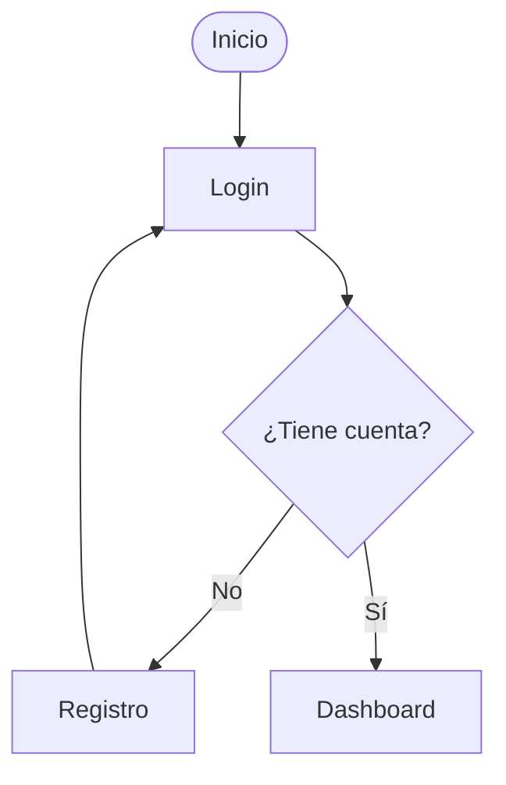

# Documentación del sistema

## Flujo general

> En GitHub los `click` de Mermaid están deshabilitados, así que usamos esta lista de navegación:

**Detalle por flujo:**

| Nodo | Diagrama detallado |
|------|--------------------|
| Login | [docs/login.md](docs/login.md) |
| Registro | [docs/registro.md](docs/registro.md) |
