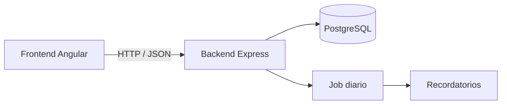
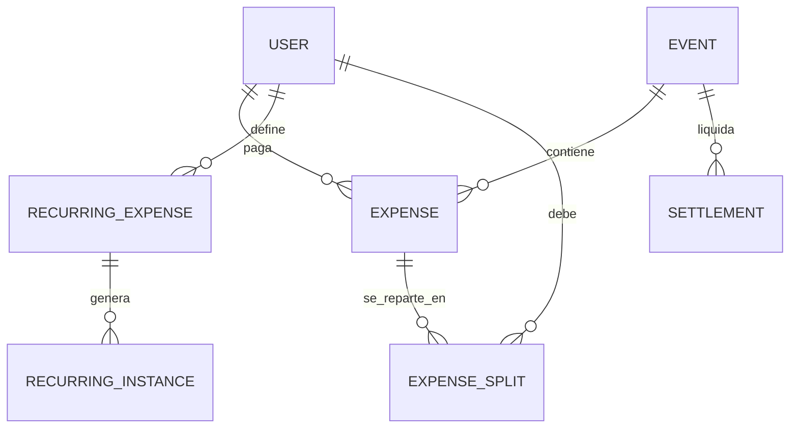
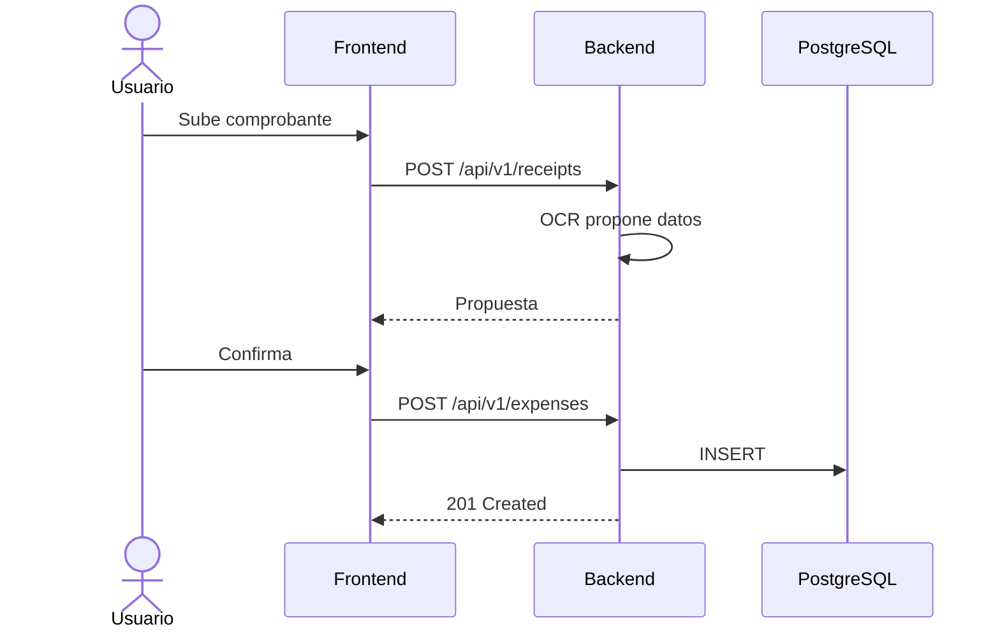
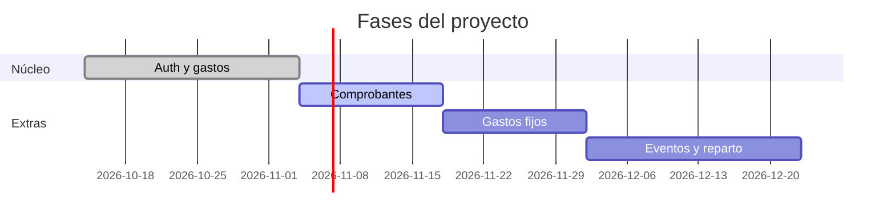
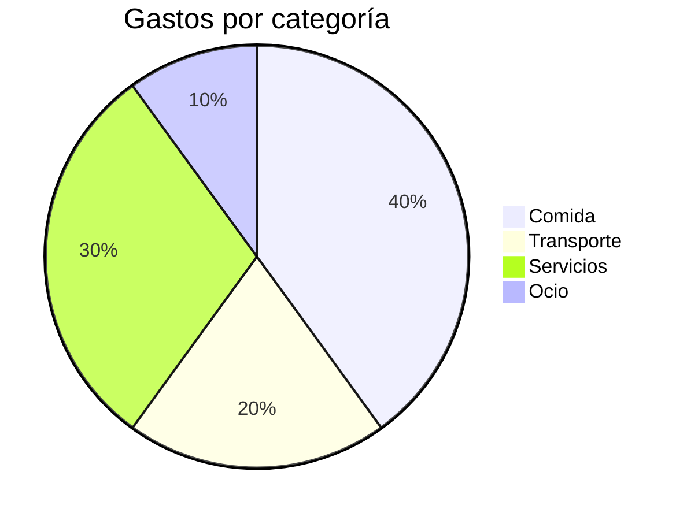
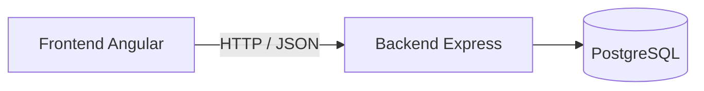
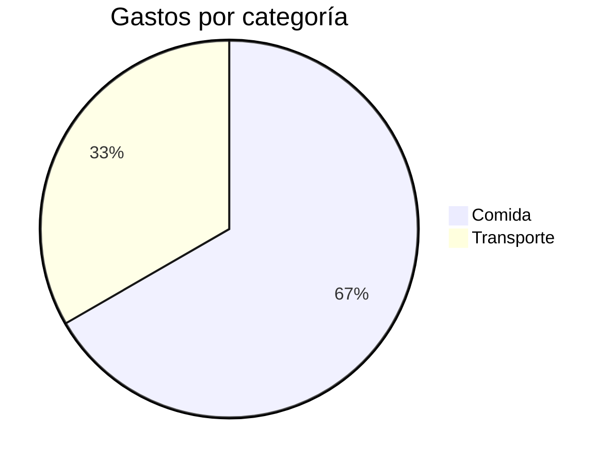

<a id="top"></a>

<div align="center">

# 🎨 Catálogo de efectos para README

Todo lo que se puede mostrar en un README de GitHub, con el código listo para copiar.
Reemplazá `TU_USUARIO` y `TU_REPO` en cada ejemplo.

[`Texto animado`](#texto-animado) [`Banners`](#banners) [`Separadores`](#separadores) [`Badges`](#badges) [`Iconos`](#iconos) [`Estadísticas`](#estadisticas) [`Diagramas`](#diagramas) [`Markdown nativo`](#markdown-nativo) [`Tema claro/oscuro`](#tema)

</div>

> [!NOTE]
> GitHub bloquea CSS y JavaScript dentro de los README. Todos los efectos animados son **imágenes SVG** que cargan desde servicios externos (por eso conviene poner siempre un `alt`). Si un servicio se cae, esa imagen deja de verse.

> [!TIP]
> Cada ejemplo tiene el código en un desplegable. Ese desplegable también es un efecto (ver [Markdown nativo](#markdown-nativo)).

---

<a id="texto-animado"></a>

## ⌨️ Texto animado (Typing SVG)

Efecto de tipeo. Se controla con parámetros en la URL: `font`, `size`, `color`, `duration`, `pause`, `repeat`, `center`, `vCenter`, `width`, `height`, `lines`, `letterSpacing`, `background`, `multiline`, `random`.

**Tipeo simple**

<div align="center">
  
</div>

<details>
<summary>Ver código</summary>

```html
<div align="center">
  
</div>
```
</details>

**Varias frases que rotan**

<div align="center">
  
</div>

<details>
<summary>Ver código</summary>

```html

```

Las frases se separan con `;` y los espacios van como `+`. Los acentos se codifican (`á` = `%C3%A1`, `í` = `%C3%AD`, `ó` = `%C3%B3`, `é` = `%C3%A9`, `ñ` = `%C3%B1`).
</details>

**Tipeo una sola vez** (queda fijo, no parpadea)

<div align="center">
  
</div>

<details>
<summary>Ver código</summary>

```html

```
</details>

**Tipografías** (cualquiera de [Google Fonts](https://fonts.google.com))

<div align="center">
  <br>
  <br>
  <br>
  <br>
  
</div>

<details>
<summary>Ver código</summary>

Solo cambia el parámetro `font` (con `+` en lugar de espacios):

```
?font=Orbitron
?font=Press+Start+2P
?font=Lexend+Giga
?font=Pacifico
```
</details>

**Espaciado, fondo y letras grandes**

<div align="center">
  
</div>

<details>
<summary>Ver código</summary>

```html

```
</details>

[`🡅`](#top)

---

<a id="banners"></a>

## 🌊 Banners (Capsule Render)

Encabezados y pies con formas, degradés y animación. Parámetros principales: `type`, `color`, `height`, `section` (`header` o `footer`), `text`, `fontSize`, `fontColor`, `animation`, `fontAlign`, `fontAlignY`, `desc`, `descSize`, `descAlign`, `descAlignY`, `reversal`, `stroke`, `strokeWidth`, `textBg`.

**Ola con degradé y animación `fadeIn`**

<div align="center">
  
</div>

<details>
<summary>Ver código</summary>

```html

```
</details>

**Otras formas** (`type=`)

<div align="center">
  
  
  
  
  
  
</div>

<details>
<summary>Ver código</summary>

Cambiá `type=` por `waving`, `egg`, `shark`, `slice`, `soft`, `cylinder`, `venom`, `rect` o `transparent`:

```html

```
</details>

**Animaciones** (`animation=`): `fadeIn`, `scaleIn`, `blink`, `blinking`, `twinkling`

<div align="center">
  
  
</div>

**Pie de página** (`section=footer`)

<div align="center">
  
</div>

<details>
<summary>Ver código</summary>

```html

```
</details>

[`🡅`](#top)

---

<a id="separadores"></a>

## ➖ Separadores

En lugar de `---`, una línea con degradé generada con Capsule Render:


<details>
<summary>Ver código</summary>

```html

```
</details>

Y una línea de puntos para secciones más suaves:

<p align="center">· · · · · · · · · · · ·</p>

[`🡅`](#top)

---

<a id="badges"></a>

## 🏷️ Badges (Shields.io)

**Estilos** (`style=`)

<div align="center">


</div>

**Con logo y colores propios**

<div align="center">


</div>

**Dinámicos** (leen datos reales del repositorio)

<div align="center">


</div>

**Barras de progreso por fase** (badges estáticos)

<div align="center">


</div>

<details>
<summary>Ver código</summary>

```markdown


```

Para que un badge sea un link: `[](url-destino)`.
</details>

**Contador de visitas**

<div align="center">
  
</div>

[`🡅`](#top)

---

<a id="iconos"></a>

## 🧩 Iconos de tecnologías

**Skill Icons** (una sola imagen con todos los íconos)

<div align="center">
  
</div>

<details>
<summary>Ver código</summary>

```html

```

Agregá `&theme=light` para la versión clara. Los nombres válidos están en [skillicons.dev](https://skillicons.dev).
</details>

**Simple Icons y Devicon** (íconos sueltos, con tamaño y color propio)

<div align="center">
  
  
  
  
</div>

<details>
<summary>Ver código</summary>

```html

```

Formato: `https://cdn.simpleicons.org/<nombre>/<color-hex>`.
</details>

[`🡅`](#top)

---

<a id="estadisticas"></a>

## 📈 Estadísticas y widgets

> [!IMPORTANT]
> Estos widgets leen datos de tu **perfil** de GitHub. Tienen sentido en el README de tu perfil (el repo `TU_USUARIO/TU_USUARIO`), no en el de un proyecto.

**Estadísticas y lenguajes** (github-readme-stats)

<div align="center">
  
  
</div>

**Tarjeta de un repositorio**

<div align="center">
  <a href="https://github.com/TU_USUARIO/TU_REPO">
    
  </a>
</div>

**Racha de contribuciones**

<div align="center">
  
</div>

**Gráfico de actividad**

<div align="center">
  
</div>

**Trofeos**

<div align="center">
  
</div>

**Frase aleatoria de programación**

<div align="center">
  
</div>

**Contribuidores y evolución de estrellas** (esto sí sirve en el README de un proyecto)

<div align="center">
  <a href="https://github.com/TU_USUARIO/TU_REPO/graphs/contributors">
    
  </a>
  <br><br>
  <a href="https://star-history.com/#TU_USUARIO/TU_REPO&Date">
    
  </a>
</div>

<details>
<summary>Ver código de todos los widgets</summary>

```html
<!-- Stats -->


<!-- Lenguajes -->


<!-- Tarjeta de repo -->


<!-- Racha -->


<!-- Actividad -->


<!-- Trofeos -->


<!-- Frase -->


<!-- Contribuidores -->


<!-- Estrellas en el tiempo -->

```

Los temas (`theme=`) disponibles incluyen `tokyonight`, `dracula`, `radical`, `gruvbox`, `onedark`, `synthwave`, `nord`.
</details>

**Serpiente que come tus contribuciones** (solo perfil)

Se genera con una GitHub Action ([Platane/snk](https://github.com/Platane/snk)) y se muestra como imagen.

<details>
<summary>Ver workflow (.github/workflows/snake.yml)</summary>

```yaml
name: Generar serpiente

on:
  schedule:
    - cron: "0 0 * * *"
  workflow_dispatch:

permissions:
  contents: write

jobs:
  generate:
    runs-on: ubuntu-latest
    steps:
      - uses: Platane/snk/svg-only@v3
        with:
          github_user_name: ${{ github.repository_owner }}
          outputs: |
            dist/github-snake.svg
            dist/github-snake-dark.svg?palette=github-dark

      - uses: crazy-max/ghaction-github-pages@v3.1.0
        with:
          target_branch: output
          build_dir: dist
        env:
          GITHUB_TOKEN: ${{ secrets.GITHUB_TOKEN }}
```

Y en el README:

```html
<picture>
  <source media="(prefers-color-scheme: dark)" srcset="https://raw.githubusercontent.com/TU_USUARIO/TU_REPO/output/github-snake-dark.svg">
  
</picture>
```
</details>

[`🡅`](#top)

---

<a id="diagramas"></a>

## 🧭 Diagramas (Mermaid, nativo de GitHub)

No necesitan servicios externos: GitHub los dibuja a partir de texto.

**Flujo**



**Diagrama entidad-relación** (útil para tu documentación)



**Secuencia**



**Cronograma (Gantt)**



**Torta**



<details>
<summary>Ver código del flujo y de la torta</summary>

````markdown



````

Otros tipos: `classDiagram` (diagrama de clases), `stateDiagram-v2`, `gitGraph`, `journey`, `mindmap`, `timeline`.
</details>

[`🡅`](#top)

---

<a id="markdown-nativo"></a>

## ✍️ Markdown nativo

**Cajas de aviso**

> [!NOTE]
> Información útil que conviene tener a mano.

> [!TIP]
> Un consejo para hacer algo mejor o más fácil.

> [!IMPORTANT]
> Lo que sí o sí hay que saber.

> [!WARNING]
> Algo que puede traer problemas.

> [!CAUTION]
> Una acción con consecuencias graves.

<details>
<summary>Ver código</summary>

```markdown
> [!NOTE]
> Información útil que conviene tener a mano.
```

Cambiá `NOTE` por `TIP`, `IMPORTANT`, `WARNING` o `CAUTION`.
</details>

**Desplegables** (el efecto que usa todo este documento)

<details open>
<summary>Este arranca abierto</summary>

Contenido oculto que se muestra al hacer clic. Acepta Markdown adentro, incluso código y tablas.
</details>

<details>
<summary>Código</summary>

```html
<details>
<summary>Título</summary>

Contenido (dejá una línea en blanco después de summary).

</details>
```

Con `<details open>` arranca expandido.
</details>

**Fórmulas matemáticas** (LaTeX)

El balance neto de cada persona se calcula como:

$$\text{balance}_i = \text{pagado}_i - \text{corresponde}_i$$

En línea también funciona: la suma de los repartos debe ser igual a $monto$.

**Teclas, sub y superíndices, emojis y notas al pie**

Presioná <kbd>Ctrl</kbd> + <kbd>C</kbd>. Agua: H<sub>2</sub>O. Al cuadrado: x<sup>2</sup>. Emojis con atajos: :rocket: :moneybag: :tada:

Texto con nota al pie.[^1]

[^1]: Así se ve una nota al pie, que GitHub lleva automáticamente al final del archivo.

**Alineación y tamaño de imágenes**

<p align="right">Alineado a la derecha</p>
<p align="center">Alineado al centro</p>


**Tabla con alineación por columna**

| Izquierda | Centro | Derecha |
|:---|:---:|---:|
| texto | texto | 1.200 |
| otro | otro | 35.000 |

**Lista de tareas**

- [x] Diseño de la arquitectura
- [x] Modelo de datos
- [ ] Autenticación
- [ ] Planilla de gastos

[`🡅`](#top)

---

<a id="tema"></a>

## 🌗 Tema claro y oscuro

Con `<picture>` mostrás una imagen distinta según el tema que use quien mira el README. Cambiá el tema de GitHub (Settings → Appearance) para verlo.

<div align="center">
  <picture>
    <source media="(prefers-color-scheme: dark)" srcset="https://readme-typing-svg.demolab.com?font=Fira+Code&size=24&color=CCA9DD&center=true&vCenter=true&width=500&height=40&lines=Estás+viendo+el+tema+oscuro">
    <source media="(prefers-color-scheme: light)" srcset="https://readme-typing-svg.demolab.com?font=Fira+Code&size=24&color=7B2FF7&center=true&vCenter=true&width=500&height=40&lines=Estás+viendo+el+tema+claro">
    
  </picture>
</div>

<details>
<summary>Ver código</summary>

```html
<picture>
  <source media="(prefers-color-scheme: dark)" srcset="URL-imagen-oscura">
  <source media="(prefers-color-scheme: light)" srcset="URL-imagen-clara">
  
</picture>
```

Sirve para logos, banners y capturas: una versión para cada tema.
</details>

[`🡅`](#top)

---

<div align="center">
  
</div>
